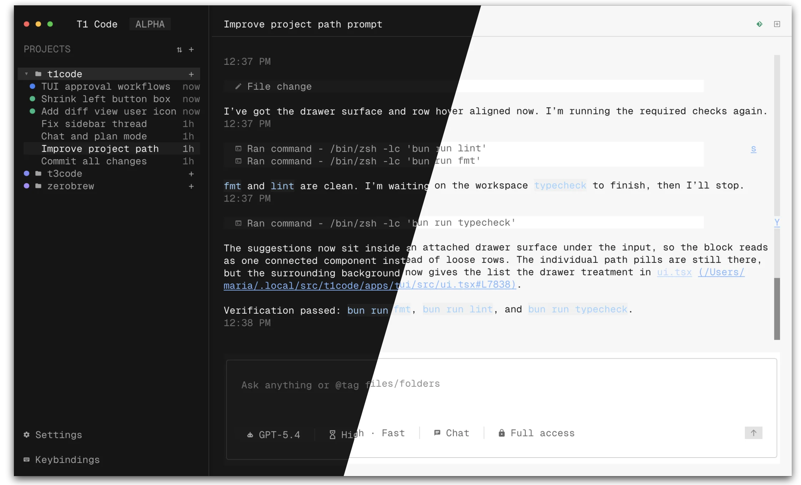

<div align="center">

# tr3x

[](./LICENSE)
[](https://github.com/phillip-hirsch/tr3x)



_T3 Code in your terminal, with Rex tabs for your agents._

</div>

tr3x is a terminal UI for coding agents. It runs on T3 Code's server and orchestration, and when you run it inside Rex, each thread can get its own Rex tab. The goal is a herdr-style multiplexer for agents; see [`docs/rex-parity-plan.md`](./docs/rex-parity-plan.md) for the roadmap.

It's an early work in progress. The move onto T3 Code's orchestration v2 is underway, so parts of the UI are still placeholders.

Develop from source (needs Node 24+, pnpm via Vite+, and Bun):

```bash
git clone https://github.com/phillip-hirsch/tr3x.git
cd tr3x
vp i
vp run dev:tui
```

tr3x keeps its data in `~/.tr3x` (`TR3X_HOME`), separate from a T3 Code install in `~/.t3`.

<sub>Built on [T3 Code](https://github.com/pingdotgg/t3code) by [@t3dotgg](https://github.com/t3dotgg) and [@juliusmarminge](https://github.com/juliusmarminge), and forked from [t1code](https://github.com/maria-rcks/t1code) by [@maria-rcks](https://github.com/maria-rcks).</sub>
